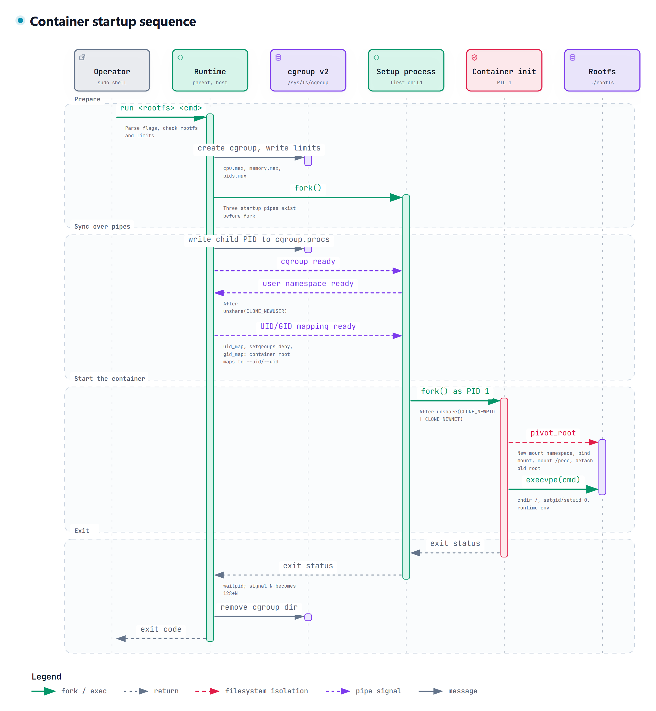

# Container Runtime

This repository contains a study-purpose container runtime written in Rust.
It isolates the filesystem, processes, network, user namespace, and hardware resources.

## How a container starts

The diagram shows the steps that the `run` command takes before it executes the command inside the container.

<picture>
  <source media="(prefers-color-scheme: dark)" srcset="assets/container-startup-dark.png">
  <source media="(prefers-color-scheme: light)" srcset="assets/container-startup-light.png">
  
</picture>

## Requirements

This project only runs on Linux. It uses namespaces, cgroup v2, `pivot_root`, and privileged `mount` calls.
On macOS, run it inside a Lima VM. See [Run on macOS through a Lima VM](#run-on-macos-through-a-lima-vm).

- A Linux host with cgroup v2 mounted in unified mode. Run `stat -fc %T /sys/fs/cgroup`, and the output must be `cgroup2fs`. Debian 11 and later, and Ubuntu 22.04 and later, use cgroup v2 by default.
- Root privileges. The runtime writes to `/sys/fs/cgroup`, and it also calls `mount` and `pivot_root`.
- A Rust toolchain that supports edition 2024, so Rust 1.85 or newer. The project was last checked with Rust 1.100.0.
- `curl` and `tar`, because `scripts/fetch-rootfs.sh` downloads and extracts an Alpine minirootfs.

## How to run

### Run directly on the host

This is the normal path on a native Debian or Ubuntu machine.

1. Fetch the rootfs. The script skips the download if `./rootfs` already has contents.

```bash
./scripts/fetch-rootfs.sh ./rootfs
```

2. Build the binary as your normal user.

```bash
cargo build --release
```

3. Run the binary with `sudo`.

```bash
sudo ./target/release/mini-container run ./rootfs \
  --cpus 1.0 --mem 536870912 --pids 1024 \
  --uid "$(id -u)" --gid "$(id -g)" /bin/sh
```

Two notes about this command:

- Avoid `sudo cargo run` when you installed Rust with `rustup`. The root PATH usually does not include `~/.cargo/bin`, so the command fails. Build first, then run the produced binary with `sudo`.
- `--uid` and `--gid` set the host user that container root maps to. `$(id -u)` and `$(id -g)` map it to yourself, so files created inside the container stay writable for you.

### Run on macOS through a Lima VM

macOS does not have the Linux kernel features that this runtime needs.
`scripts/lima.sh` runs the runtime inside the Lima VM that `lima/mini-container.yaml` defines.

1. Install Lima 2.0 or later.

```bash
brew install lima
```

2. Fetch the rootfs into the VM. The first call creates and starts a VM named `mini-container`, so it takes a few minutes.

```bash
./scripts/lima.sh rootfs
```

3. Run a command in a container. The script builds the binary inside the VM before each run.

```bash
./scripts/lima.sh run /opt/mini-container/rootfs \
  --cpus 1.0 --mem 536870912 --pids 1024 /bin/sh
```

### Development commands

The Makefile only holds formatting and linting targets.

```bash
make fmt    # cargo fmt
make lint   # cargo clippy --all-features
```
